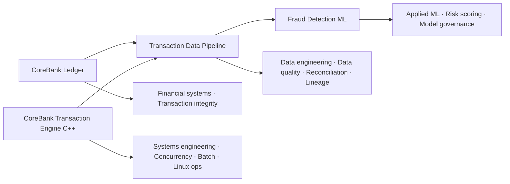

# Tio Aldino

**Banking Technology & Engineering Leader**
Financial Systems · Software Engineering · Data & AI · Security

Head of IT | Software Engineer at heart | MSc Data Science
London, United Kingdom

---

## About

More than ten years in banking technology, from core banking analysis and software engineering to heading the IT function of an international bank's London branch. The combination is what makes the background different: deep **banking domain** knowledge (core banking, payments, treasury, reconciliation, financial reporting), hands-on **software engineering**, **data & AI** applied to financial services, **security and identity** in regulated environments, and **technology leadership** across international banking operations.

This profile holds source code, architecture and engineering work. The career story, banking project case studies and MSc Data Science work live in my [professional portfolio](https://adetlo.github.io/eportofolio/).

## Featured Engineering Projects

Four independently runnable, production-style projects around one financial transaction lifecycle: **record it, process it at the systems level, curate it, score it**. Each ships a full test suite, CI, Docker and architecture decision records, and uses synthetic data only.

| Project | What it demonstrates | Stack · CI |
| --- | --- | --- |
| **[corebank-ledger](https://github.com/Adetlo/corebank-ledger)** *Financial transaction integrity* | Production-style double-entry ledger demonstrating financial transaction integrity, atomic posting, idempotency, immutable postings, reversals and reconciliation | Python · FastAPI · PostgreSQL  |
| **[corebank-transaction-engine-cpp](https://github.com/Adetlo/corebank-transaction-engine-cpp)** *Systems engineering: C++, concurrency, batch, Linux operations* | Production-style C++20 core-banking transaction engine demonstrating exact money handling, atomic and idempotent posting, a tested transaction state machine, striped locking and worker pools, reconciliation, a restartable end-of-day batch and shell-driven Linux operations | C++20 · CMake · SQLite · Bash  |
| **[txn-data-pipeline](https://github.com/Adetlo/txn-data-pipeline)** *Data quality, reconciliation and lineage* | Production-style financial transaction pipeline demonstrating multi-format ingestion, data quality controls, idempotent processing, quarantine, reconciliation, lineage and analytics-ready modelling | Python · Parquet · DuckDB · PostgreSQL  |
| **[fraud-detection-ml](https://github.com/Adetlo/fraud-detection-ml)** *Risk scoring, model governance and monitored inference* | Fraud risk scoring and decision-support system demonstrating temporal validation, leakage-safe features, class imbalance handling, threshold optimisation, explainability and drift monitoring | Python · scikit-learn · XGBoost · FastAPI  |

The ledger records transactions, the C++ engine shows the same transaction path built at the systems level (compiled service, worker pool, end-of-day batch, shell operations), the pipeline validates and reconciles their exports, and the ML service scores the curated result. The integration is conceptual rather than live: each repository defines its own contract and sample data, so any one of them can be cloned and run on its own.

## Next Engineering Projects

Planned for the same portfolio; not yet published.

- `entra-id-toolkit` — Microsoft Entra / Microsoft Graph identity governance and security engineering toolkit
- `secure-banking-api` — Secure-by-design banking-style REST API with authentication, audit logging, validation and security controls
- `platform-devops-blueprints` — Reusable CI/CD, Docker, GitHub Actions and infrastructure patterns for the engineering portfolio

## Core Expertise

| Domain | Expertise |
| --- | --- |
| **Financial Technology** | Core banking · Payments · Treasury systems · SWIFT / ISO 20022 · AML / transaction monitoring · Financial reporting · Reconciliation · Enterprise integration |
| **Enterprise & Core Banking Engineering** | COBOL · AIX · Oracle · SQL · PL/SQL · Shell |
| **Modern Software Engineering** | C++ · Python · Java · FastAPI · REST APIs · Git · Object-oriented programming · Concurrency |
| **Data & AI** | Pandas · NumPy · Scikit-learn · Data engineering · Machine learning · Analytics · Forecasting · Anomaly detection |
| **Cloud & Identity** | Microsoft Azure · Microsoft Entra ID · RBAC · Conditional Access · Identity and access management |
| **Security & DevOps** | Cybersecurity · Docker · GitHub Actions · CI/CD · Secure software engineering |
| **Databases** | Oracle · PostgreSQL · SQLite · MySQL |

Core banking runs on enterprise platforms: COBOL, AIX and Oracle remain first-class skills here, alongside the modern Python, cloud and AI stack.

## Professional Portfolio

Career journey, international banking technology experience, project case studies, leadership experience and MSc Data Science work:

**[adetlo.github.io/eportofolio](https://adetlo.github.io/eportofolio/)**

## Certifications

- **Microsoft Applied Skills** — Microsoft Entra Identity and Access
- **Oracle Cloud Infrastructure** — Certified AI Foundations Associate
- **Oracle** — Agentic AI Certified Foundations Associate
- **PCAP** — Certified Associate Python Programmer
- **PCEP** — Certified Entry-Level Python Programmer
- **Oracle** — PL/SQL Developer Certified Associate
- **Oracle** — Database SQL Certified Associate

## Education

- **MSc Data Science** — University of Essex
- **BSc Computer Science** — BINUS University

## Current Focus

- Banking technology modernisation
- Financial automation
- Applied AI in financial services
- Data engineering
- Secure enterprise platforms
- Identity and access management

## Connect

- **GitHub** — [github.com/Adetlo](https://github.com/Adetlo)
- **LinkedIn** — [linkedin.com/in/ade-putra-tio-aldino-17990753](https://www.linkedin.com/in/ade-putra-tio-aldino-17990753/)
- **Professional portfolio** — [adetlo.github.io/eportofolio](https://adetlo.github.io/eportofolio/)
- **Email** — [putratioaldino@gmail.com](mailto:putratioaldino@gmail.com)
